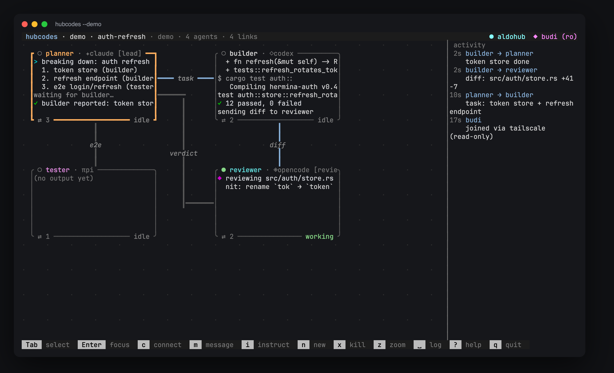

# hubcodes

A canvas for orchestrating several AI coding agents at once, built in Rust on top of tmux. Two clients share one tmux session: a **desktop app** (Tauri + React, the main face) and a **terminal UI** for SSH and quick checks.

Agents (Claude Code, Codex, OpenCode, Pi, OMP, Gemini CLI, Antigravity CLI (`agy`), Hermes Agent, or a plain shell) run as ordinary tmux panes, one window each. hubcodes draws them as nodes on an infinite canvas, draws the links between them, animates the messages that cross those links, and shows a live preview of each agent's terminal. Press `Enter` on a node and the agent's real terminal is tiled next to the map; `Esc` or `Alt+Esc` brings you back.



> Status: **0.1.x, in daily use** (2026-11-14). Desktop app, tmux backend, provider adapters, message path with delivery queue, roles synced into every provider, status hooks for claude, codex, opencode, pi and omp, sharing over Tailscale with redacted previews, and a daemon (`hubcodesd`) that keeps it all running while the app is closed. What is still open: [docs/roadmap.md](docs/roadmap.md).

## Why

Running three or four agents in parallel moves the state of the project into your head: who is doing what, who is waiting on whom, which one needs a `y`. Maestri solves that with a native macOS canvas; T3 Code solves it with a Git-centric Electron app. hubcodes keeps the idea but stays in the terminal:

- **tmux owns the PTYs.** Agents survive detach, multiple clients can attach, and the orchestrator costs a few megabytes.
- **Agents stay native.** No terminal emulator of our own, no wrapped UI. The canvas shows a preview; focus mode is the real thing.
- **One binary, any provider.** A provider is a command plus a glyph plus a "waiting for a human" pattern.
- **Agents talk through the shell.** `hubcodes send reviewer "diff is ready"` works from any agent that can run a command, which is all of them.

See [docs/reference-teardown.md](docs/reference-teardown.md) for the evidence-based comparison with Maestri and T3 Code.

## Install

The repository is private to the [HubStudio-id](https://github.com/HubStudio-id) organization, so you need a GitHub account that is a member of it, signed in to `gh`. Builds: macOS on Apple silicon, Linux x86_64 and aarch64, and Windows through WSL 2 (hubcodes runs on tmux, which Windows does not have).

**macOS (Apple silicon)**

```bash
brew install gh tmux
gh auth login                      # GitHub.com, HTTPS, sign in with your HubStudio-id account
gh api -H "Accept: application/vnd.github.raw" repos/HubStudio-id/hubcodes/contents/install.sh | sh
```

Puts `hubcodes.app` in `/Applications` and links the bundled CLI to `~/.local/bin/hubcodes`. The build is signed but not notarized yet, so the installer clears the quarantine flag itself.

**Linux (any distribution with glibc 2.35 or newer)**

Ubuntu / Debian:

```bash
sudo apt install gh tmux libfuse2  # libfuse2t64 on Ubuntu 24.04; gh: https://github.com/cli/cli/blob/trunk/docs/install_linux.md
gh auth login
gh api -H "Accept: application/vnd.github.raw" repos/HubStudio-id/hubcodes/contents/install.sh | sh
```

Fedora:

```bash
sudo dnf install gh tmux fuse-libs # fuse-libs is the FUSE 2 library the AppImage needs
gh auth login
gh api -H "Accept: application/vnd.github.raw" repos/HubStudio-id/hubcodes/contents/install.sh | sh
```

On another distribution install `gh`, `tmux` and FUSE 2 with its package manager, then run the same two `gh` lines. Flatpak is not offered: hubcodes drives tmux and the coding tools on the host, which a Flatpak sandbox would have to bypass for every command.

Puts the CLI in `~/.local/bin/hubcodes`, the desktop app (an AppImage that updates itself) in `~/.local/bin/hubcodes-desktop`, and a hubcodes entry in the applications menu. `HUBCODES_NO_DESKTOP=1` installs the CLI only, for a server you reach over SSH. The background daemon runs as a systemd user service (`hubcodes daemon install`). A `.deb` is attached to each release too, for `sudo apt install ./hubcodes_<version>_amd64.deb`, but it does not update itself.

**Windows (WSL 2)**

Install WSL with Ubuntu first if you have not (`wsl --install -d Ubuntu` in an administrator PowerShell, restart, open Ubuntu once). Then, in a normal PowerShell with `gh` signed in (`winget install GitHub.cli`, `gh auth login`):

```powershell
gh api -H "Accept: application/vnd.github.raw" repos/HubStudio-id/hubcodes/contents/install.ps1 | powershell -NoProfile -Command -
```

It installs tmux, gh and hubcodes inside WSL (asking you to sign in to GitHub there once) and prints how to start it: `wsl bash -lc hubcodes-desktop` opens the canvas as a Linux window through WSLg. The coding tools (Claude Code, Codex, OpenCode…) have to be installed inside WSL too, and your repositories are best kept in the Linux file system (`~/code`), not under `/mnt/c`.

Without `gh`, `install.sh` falls back to `curl` + `python3` and reads `GH_TOKEN`, which needs read access to this repository.

Or let a coding agent do it. Paste this into Claude Code, Codex, OpenCode or any agent that can run shell commands:

```text
Install hubcodes for me from the private GitHub repository HubStudio-id/hubcodes:
run `gh api -H "Accept: application/vnd.github.raw" repos/HubStudio-id/hubcodes/contents/install.sh | sh`
(install gh and tmux first if they are missing, with brew on macOS or the package manager on Linux; on Windows use install.ps1 instead, which installs into WSL; if gh is not signed in, tell me to run `gh auth login`),
then run `hubcodes setup` (add `--source ~/.hub-skills/skills` if that folder exists) and fix or report what it says is failing.
```

`hubcodes setup` turns skills sync on, links your skill folders into every coding tool, and installs a `hubcodes` skill in each of them. From then on you can ask any agent in plain words: "update hubcodes", "add this skill: <link>", "pull the hub skills", "copy the pr-review skill from mini", "is every tool in sync?". It runs the matching `hubcodes` command.

If `gh api` answers `404 Not Found`, your account cannot read the repository yet: ask a repository admin to add you (or your team) with at least Read access.

### What the installer changes

Nothing outside these paths, and no `sudo`:

- `/Applications/hubcodes.app` (replaced on reinstall; a running copy is quit first)
- `~/.local/bin/hubcodes`, a link to the CLI inside the app
- the quarantine flag on `hubcodes.app`, cleared because the build is signed but not notarized yet

The release holds only the app: no config, tokens or project data. Your settings are created on first run in `~/.config/hubcodes/hubcodes.toml`, and secrets in it are referenced as `${ENV_VAR}` or `${keychain:NAME}`, never written in plain text. Updates are verified against the signing key in `desktop/src-tauri/tauri.conf.json` before they install, and nothing installs without your click. Once running, the app also writes into the coding tools it drives: role agent files such as `~/.config/opencode/agent/hub-<role>.md`, a `hubcodes` MCP entry that does nothing outside a hubcodes agent, and, when skills sync is on, links in each tool's skills folder. To remove hubcodes, quit it and delete the two paths above plus `~/.config/hubcodes` and `~/.local/state/hubcodes`.

After that:

1. Run `hubcodes setup` (skills sync and the `hubcodes` skill, then a check) or just `hubcodes doctor`. The check covers tmux, `PATH` and the coding tools you have installed (Claude Code, Codex, OpenCode, Pi, OMP, Gemini CLI, Antigravity CLI, Hermes Agent).
2. Open hubcodes from `/Applications`. `⌘N` starts an agent.
3. Updates arrive in the app (Settings → General → Updates): the macOS app and the Linux AppImage replace themselves. The app reads the release feed with the same `gh` login, so stay signed in. On Linux the app also brings `~/.local/bin/hubcodes` to its version. Without the app (a server, WSL with `HUBCODES_NO_DESKTOP=1`): `hubcodes update --check` shows the installed and the latest version, patch releases included, and `hubcodes update` installs it. `hubcodes doctor` reports the same on its Version line. The version the app runs is shown at the bottom of the Settings menu and under General → Updates, with a tag when a newer one is available.

To share agents between Macs on one tailnet, see the [team guide](docs/team-guide.md) (Settings → Remote access, `hubcodes serve`). Homebrew: the cask in [`Casks/hubcodes.rb`](Casks/hubcodes.rb) installs the same bundle once a tap `HubStudio-id/homebrew-hubcodes` holds it (`brew install --cask HubStudio-id/hubcodes/hubcodes`).

## Quick start (desktop)

Requirements: macOS or Linux, tmux ≥ 3.2, Rust ≥ 1.88, Node ≥ 20 with pnpm.

```bash
cd desktop && pnpm install
pnpm tauri dev          # development build with hot reload
pnpm build:mac          # signed .app / .dmg in target/release/bundle (repo root)
```

The app creates (or attaches to) the `hubcodes` tmux session. `⌘N` starts an agent, typing in a node's composer sends to it, `Enter` on an empty composer opens the agent full size, `Esc` goes back, `⌘K` lists every command. Start a composer line with `@name` to send it to another agent along a link instead. The canvas behaves like a design tool: drag empty space or scroll to pan, `⌘` + scroll or pinch to zoom, `⌘+` / `⌘−` / `⌘0`, nodes turn into name-and-status cards when zoomed out, a selected card has resize corners and a toolbar (Open · Link to… · Remove), a link is made by dragging from a port and dropping anywhere on the other card, and right-click on a card or in the rail opens the agent menu. `⌫` on a selected agent removes it (stops the process, closes the tmux pane) after a confirmation. Agents started from a shell with `hubcodes spawn …` appear on the canvas within half a second, and the other way round.

Every agent can carry a **role** (orchestrator, software engineer, reviewer…), a **model**, and an **account** (a separate login of the tool, so three Claude panels can run on three subscriptions; Settings → Providers → Accounts). Both are set in New agent. The model list is the provider's own: Claude Code's picker cache (`~/.claude.json`) plus its aliases, Codex's `~/.codex/models_cache.json`, `opencode models`, pi's `~/.pi/agent/models.json`, omp's `modelRoles` plus its `models.yml` and `models.db`, `agy models` for the Antigravity CLI, the default model in `~/.hermes/config.yaml` for Hermes Agent (any id its signed-in provider takes can be typed); `hubcodes providers` prints the same from a shell. Settings → Providers → **Models on this device** lists what each installed tool offers here (the default marked, *Read again* to reload), and **Sync** next to Model in New agent reads the list again, from the chosen device when the agent runs on another one. The model picker is a searchable list; an id that is not in it can still be typed and is passed as is. A provider that is not installed or not signed in shows a Connect panel with the install and login commands and, for hermes, codex, opencode, claude, gemini and agy, a **Sign in** button that opens the tool's own sign-in (`hermes model`, `codex login`…) as a pane on the canvas, and Settings → Providers → Check shows the same for any provider. The role is a chip on the node you can click to change, the model is passed to the provider's model flag (`claude --model opus`, `codex --model gpt-5-codex`) and, for providers with a role flag (claude, pi, omp), the role is handed to the agent as a system prompt (providers without one, gemini, agy and hermes, get the same text as their first message, once, when the tool has been idle 15 s after start) so it knows its job and how to reach the others. That prompt also carries a start brief: an orchestrator is told to split the request and hand it to its engineers and reviewer with `hubcodes send` / `hubcodes task add --role`, not to edit code itself; an engineer is told to report back to the orchestrator when done (only when a line on the canvas connects it to an orchestrator, directly or through other agents, whatever that orchestrator is named; an agent with no such line reports to whoever asked and needs no go-ahead); a reviewer to answer with findings rather than rewrites. The role is synced into each tool the way that tool supports: claude runs as a named session agent (`--agents … --agent hub-<role>`, with the role prompt appended to its normal system prompt); opencode gets an agent file `~/.config/opencode/agent/hub-<role>.md` rewritten at every start and runs `opencode --agent hub-<role>` (its status line shows the role); codex gets the prompt as `-c developer_instructions=…`; pi and omp take `--append-system-prompt`. The brief lists the teammates running at that moment (`hubcodes ls` for the live list), so start the orchestrator after its team, or restart it when the team changes. The rule is enforced, not only prompted: a human's message to an orchestrator carries a one-line delegation reminder, and the provider hooks refuse an orchestrator's file edits, builds, tests and git writes with a reason that names its engineers (`hubcodes guard`; `[workspace] guard_orchestrator = false` turns it off). Agents started with an older brief are flagged in the app with *Restart with the current brief* (`hubcodes restart <name>`). To move a running agent to another provider or model, press **Switch** (the ⇄ icon on the selected card's toolbar, or in its panel; `hubcodes switch <name> -p codex [-m model]`): it keeps its name, role, folder and links; on the same provider the conversation continues on the new model, and a new provider starts with a hand-over note in its brief (its open board tasks, recent messages and the end of the old terminal). The same happens by itself when a tool runs out (a usage limit, no credit, no quota): turn on Settings → Agents → **When a provider runs out** and list the order to try (`[failover] chain = ["claude:opus", "claude:sonnet", "codex"]`); the agent moves to the next one that is installed and not resting, and is told to carry on. When work piles up, **Auto team** (Settings → Agents) adds temporary agents per role, up to a limit (default 2 per role), and removes them once idle with nothing waiting; unfinished work stays on the extra agent's branch and is handed to another agent (`hubcodes hire`, `hubcodes release`). To change what a role is told, open Settings → Workspace → **Roles**: the editor starts from the text hubcodes uses today (`{lead}` stands for the orchestrator's name), and saving writes `~/.config/hubcodes/roles/<role>.md`; the live team facts (who runs, the lead, canvas links) are still added after it, and *Back to the default* removes the file. Or write a role file by hand: `<repo>/.hubcodes/roles/<role>.md` for one repository or `~/.config/hubcodes/roles/<role>.md` for all (`hubcodes role init "<role>"` writes a starting file, `hubcodes role show "<role>"` prints what the agent gets; the New agent dialog shows the same under *What this role is told*).

**For a team** — one branch per agent with a diff viewer, a goal board that hands tasks to idle agents, fan-out to several agents with a collector, saved `/prompts`, shared notes, an approval inbox, a searchable transcript, token budgets, cron / PR / webhook triggers, a phone page for teammates over Tailscale, pluggable team memory (built-in, Hindsight, any MCP server, or a command) and knowledge sources (MCP, docs repo, folder, Confluence, Jira, command), plus per-repo teams, a test runner, a merge queue, a review gate, restore after restart, alerts, sandboxing, presence, the canvas in a browser, an auto-approve policy, playbooks (plan → build → review → merge with gates) and issue-tracker sync (Jira, Plane, GitHub, or any tracker through a command or MCP): [docs/team-guide.md](docs/team-guide.md).

**Loops.** Select a link → *Loop…*, give a goal: the two agents hand results to each other (`hubcodes send` with a trailer telling the receiver how to answer) until one replies `DONE` or the round limit pauses it, with a reminder when an agent forgets to answer. **Devices.** Settings → Devices adds another machine over SSH/Tailscale; its agents appear as `mini/reviewer`, can be linked, looped and messaged, and message yours back. Details: [docs/loops-and-devices.md](docs/loops-and-devices.md).

When an agent enters *needs you* while the window is in the background you get an OS notification (macOS asks once whether to allow them), and the Dock badge counts the agents waiting. `⌘,` opens Settings: providers (command, glyph, colour, waiting pattern) and the default folder are saved to `~/.config/hubcodes/hubcodes.toml`.

For a signed build on macOS run `pnpm build:mac`; it uses the best code-signing identity in your keychain (Developer ID, else Apple Development, else ad-hoc) and prints the `.app` and `.dmg` paths. Notarization needs a Developer ID certificate and `APPLE_ID`, `APPLE_PASSWORD` (app-specific), `APPLE_TEAM_ID` in the environment.

## Quick start (terminal UI)

Requirements: macOS or Linux, tmux ≥ 3.2, Rust ≥ 1.88 (`rustup`). A terminal with true colour and a Nerd Font looks best (Ghostty, WezTerm, kitty, iTerm2).

```bash
gh repo clone HubStudio-id/hubcodes && cd hubcodes
cargo build --release
export PATH="$PWD/target/release:$PATH"

# 1. Judge the UX without any agent or tmux:
hubcodes --demo

# 2. Real thing: creates (or attaches) the `hubcodes` tmux session with the canvas in window 0.
hubcodes
```

Inside the canvas, select a node and just type: the text lands in the node's composer and `Enter` sends it to that agent, like Maestri and T3 Code. `Enter` on an empty composer **opens** the agent: its real terminal is tiled next to the canvas (the canvas shrinks to a sidebar with the agent list and composer) and gets the keyboard. `Esc` or `Alt+Esc` brings you **back**. `Ctrl+T` tiles every agent at once, like a tiling window manager. `Ctrl+N` spawns an agent (Tab cycles the provider), `Ctrl+K` connects two agents, `Ctrl+G` sends a message along a link, `F1` lists all keys.

From any shell (including from inside an agent):

```bash
hubcodes spawn reviewer -p opencode --cwd ~/code/api   # new tmux window running `opencode`
hubcodes spawn lead -p claude -r orchestrator -m opus  # role shown on the node and told to the agent; model → `claude --model opus`
hubcodes connect builder reviewer --label diff          # draw a link
hubcodes send reviewer "diff is ready in src/auth"      # paste into reviewer's terminal + animate the link
hubcodes read builder --lines 40                        # last lines of builder's terminal (ANSI stripped)
hubcodes ls                                              # agents and links in the session
hubcodes open reviewer                                   # tile reviewer's terminal next to the canvas
hubcodes tile                                            # tile every agent
hubcodes back                                            # everything back to its own window
hubcodes loop start planner builder "ship the token store"  # agents answer each other until DONE or the round limit
hubcodes loop status
hubcodes send mini/reviewer "diff is ready"              # an agent on another device ([[peer]] in hubcodes.toml)
hubcodes peers                                           # reachability of the other devices
hubcodes providers                                       # installed / logged in / models per provider
hubcodes spawn dev -p claude -r "software engineer" --worktree agent/dev   # own git worktree + branch
hubcodes team start full-stack                           # agents + links + loops from a template
hubcodes task add "write the store" --role "software engineer"   # goal board; an idle engineer picks it up
hubcodes fanout "best name?" --to a,b,c --collect judge  # fan-out / fan-in
hubcodes note add "store API stays"                      # shared notes (hubcodes note show)
hubcodes approve reviewer                                # answer its permission prompt
hubcodes log --grep auth                                 # the transcript (SQLite)
hubcodes usage                                           # tokens per agent, budget limits
hubcodes daemon install                                  # hubcodesd under launchd (macOS) or a systemd user service (Linux, WSL): tends every session + the phone page while the app is closed
hubcodes watch --serve                                   # the same for one session, from a terminal
hubcodes test api                                        # run the repo's tests in the agent's folder
hubcodes merge api                                       # queue its branch into main: tests first, conflicts become a task
hubcodes restore                                         # bring back the saved session after a reboot (claude -c, codex resume)
hubcodes team init                                       # write the running canvas as this repo's .hubcodes/team.toml
hubcodes provider export claude > claude.toml            # share a provider setup with the team
```

Agents spawned by hubcodes get `HUBCODES_AGENT=<name>` and `HUBCODES_SESSION=<session>` in their environment, so `hubcodes send` from inside an agent is attributed automatically.

## Keys

| Key | Action |
|---|---|
| type | instruct: text goes into the selected node's composer (bottom row of the card) |
| `Enter` | send the draft to the agent; with an empty draft: **open** the agent's real terminal next to the canvas |
| `Esc` | clear the draft; with an empty draft: **back** (every open agent returns to its own window) |
| `Ctrl+T` | tile every agent next to the canvas; press again to cycle tmux layouts |
| `Ctrl+W`, `Ctrl+B` | close the selected open agent / back |
| `Tab` / `Shift-Tab` | select next / previous agent (each node keeps its own draft) |
| click, drag | select / move a node; drag empty space to pan; wheel scrolls |
| `Alt+Esc`, `prefix g` | back to the canvas from inside any agent pane (runs `hubcodes back`) |
| `Ctrl+K`, right-click | connect selected agent → target (`Enter` toggles the link) |
| `Ctrl+G` | agent → agent message along a link (`Tab` cycles the recipient) |
| `Ctrl+N`, `F2`, click on an empty canvas | spawn a new agent (`Tab` cycles the provider) |
| `Ctrl+X` | kill the selected agent's window (asks first) |
| `Ctrl+Z` | zoom: full nodes ↔ compact nodes |
| arrows | pan (`Shift` = faster); `Ctrl+O` resets the camera |
| `Ctrl+L` | toggle the activity panel |
| `F1`, `?` | help; `Ctrl+Q` / `Ctrl+C` quit the canvas, agents keep running in tmux |

## Configuration

`./hubcodes.toml` (per project) or `~/.config/hubcodes/hubcodes.toml` (`$XDG_CONFIG_HOME` respected). See [hubcodes.example.toml](hubcodes.example.toml). The desktop Settings dialog writes the user-level file.

Node positions and the camera are saved per tmux session to `~/.local/state/hubcodes/<session>.json` (or `$XDG_STATE_HOME/hubcodes/`), keyed by agent name, so a canvas restart keeps your layout. Delete the file to reset it.

```toml
[[provider]]
name = "claude"
command = "claude"
glyph = "✦"
color = 215                      # xterm-256 index for the node accent
waiting_pattern = "(?i)allow|y/n" # optional, marks the node "needs you"
model_flag = "--model {model}"   # optional, how a model is passed
role_flag = "--append-system-prompt 'You are the {role}…'"  # optional, how the role is told
models = ["opus", "sonnet"]      # extra suggestions in New agent
models_command = "mytool models" # optional: one model id per line, read from the tool

[[workspace.agents]]             # spawned on first launch
name = "planner"
provider = "claude"
role = "lead"

workspace.edges = [["planner", "builder"]]

[desktop]                        # desktop app only
notifications = true
default_folder = "~/code"
roles = ["orchestrator", "software engineer", "reviewer"]

[loop]
max_rounds = 20                  # a loop pauses after this many messages; 0 = no limit

[budget]
max_tokens_per_agent = 0         # 0 = no limit; from the agents' own transcripts

[serve]                          # phone / teammate page, bound to the Tailscale IP
bind = "tailscale"
port = 7433
[[share]]
user = "budi@hubstudio.id"
role = "operator"                # viewer | operator | owner

[[prompt]]
name = "review"
text = "Review {last_diff} on {branch}"

[[template]]
name = "pair"
agents = [{ name = "builder", provider = "claude", role = "software engineer" }, { name = "reviewer", provider = "codex", role = "reviewer" }]
links = [["builder", "reviewer", "loop"]]

[[trigger]]
name = "nightly"
on = "cron 0 9 * * 1-5"
action = "loop start lead reviewer \"Review every open PR\""

[sharing]
name = "mac"                     # this device, as peers see it

[[peer]]                         # another machine running hubcodes
name = "mini"
host = "mac-mini.tailnet.ts.net"
session = "hubcodes"
```

Built-in providers: `claude`, `codex`, `opencode`, `pi`, `omp`, `gemini`, `agy`, `hermes`, `shell`.

## How it works, in one paragraph

tmux is the process supervisor and the state bus. Each agent is a tmux window tagged with a `@hubcodes_provider` option. Links and the last message are stored in tmux session options (`@hubcodes_edges`, `@hubcodes_last_msg`), so the CLI and the canvas share state without a server in between. Every 500 ms the canvas lists windows, captures the last 12 lines of each pane (`capture-pane -e`), and shows *working / idle / needs you / offline* from the agent's own hook reports (claude, codex, opencode, pi, omp), with a screen-change heuristic as the fallback. `hubcodesd` (optional, launchd) tends every session and pushes events while the app is closed. Messages are pasted into the target pane with `load-buffer` + `paste-buffer` and acknowledged with `Enter`. Full details and diagrams: [docs/architecture.md](docs/architecture.md).

## Documentation

| Document | What it covers |
|---|---|
| [docs/README.md](docs/README.md) | index |
| [docs/architecture.md](docs/architecture.md) | components, data model, sync loop, message path, phase-2 daemon (with diagrams) |
| [docs/ui-ux.md](docs/ui-ux.md) | canvas design, node anatomy, edge routing rules, interaction modes |
| [docs/providers-and-protocol.md](docs/providers-and-protocol.md) | provider adapters, status heuristics, message protocol v0, CLI, agent prompt snippet |
| [docs/team-guide.md](docs/team-guide.md) | the team features: sidecar CLI, hook status, worktrees, teams, board, fan-out, prompts, notes, remote page, inbox, transcript, budgets, triggers |
| [docs/loops-and-devices.md](docs/loops-and-devices.md) | agent-to-agent loops and multi-device setup over SSH/Tailscale (built) |
| [docs/sharing-and-security.md](docs/sharing-and-security.md) | sharing a canvas with other people over Tailscale, permission model, threat model (design) |
| [docs/reference-teardown.md](docs/reference-teardown.md) | Maestri and T3 Code teardown with REA evidence |
| [docs/roadmap.md](docs/roadmap.md) | phases and acceptance criteria |
| [docs/evidence/README.md](docs/evidence/README.md) | captured evidence files and their hashes |

## Known limitations

- Status for providers without a hook (agy, hermes, shell, custom ones without `hook_kind`) is a heuristic: pane changed recently → working; prompt-like last line → needs you.
- Previews are 12 lines of `capture-pane`; wide glyphs in fancy prompts can shift a line by a cell.
- No native Windows build: tmux is required, so Windows runs hubcodes inside WSL 2 (`install.ps1`).
- Desktop builds signed with an *Apple Development* certificate run on the signing Mac only; other Macs see a Gatekeeper warning until the build is signed with a Developer ID certificate and notarized.
- `cargo build`, `cargo test` and `cargo clippy` pass with no warnings.

## Development

```bash
cargo build            # debug build
cargo test             # routing unit tests
scripts/test-peers-local.sh   # two devices on one Mac: cache, roster, guard, dispatch, task done a:1, queue, max_agents
scripts/test-cli-local.sh     # the CLI end to end in a throwaway config: --json readers, task show/edit/place, board, peer, completions
cargo run -- --demo    # scripted demo, no tmux needed
python3 scripts/tmux2png.py hc-demo docs/screenshots/demo-canvas.png   # screenshot a tmux pane via headless Chrome
```

### Releasing

Only maintainers who hold the updater signing key (`~/.tauri/hubcodes.key`, never in the repository) can publish a release that installed apps accept.

1. `scripts/bump-version.sh 0.1.28`, commit and push.
2. `cd desktop && pnpm build:mac`. It signs the updater tarball with `~/.tauri/hubcodes.key` when that file exists (or `TAURI_SIGNING_PRIVATE_KEY_PATH`).
3. `desktop/scripts/release-github.sh --notes "What changed"` tags `v<version>` on `HubStudio-id/hubcodes`, uploads the dmg, the updater tarball and `latest.json`, and pins the dmg checksum in `Casks/hubcodes.rb`.
4. Commit the cask change ("Pin the cask to 0.1.28") and push.
5. Publishing the release starts the `linux` workflow (`.github/workflows/linux.yml`): it builds the AppImage, `.deb` and CLI for x86_64 and aarch64 on GitHub's runners, attaches them, and adds the `linux-*` entries to `latest.json`. It signs with the repository secret `TAURI_SIGNING_PRIVATE_KEY` (the key file's contents; add `TAURI_SIGNING_PRIVATE_KEY_PASSWORD` only if the key has a password); a maintainer adds them once with `gh secret set TAURI_SIGNING_PRIVATE_KEY -R HubStudio-id/hubcodes < ~/.tauri/hubcodes.key`. To rebuild one release: Actions → linux → Run workflow with the tag.

Details: [docs/team-guide.md](docs/team-guide.md) (signing, notarization, the update feed).

## License

MIT.
