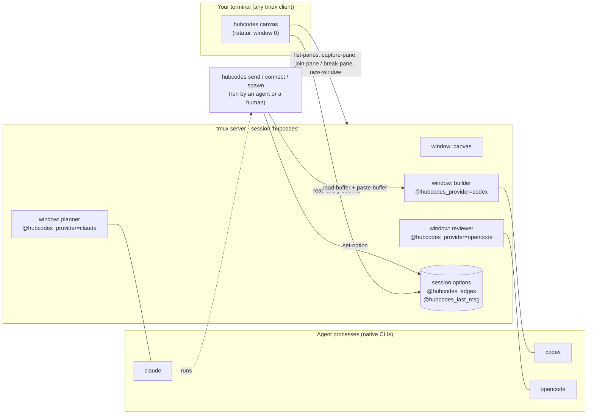
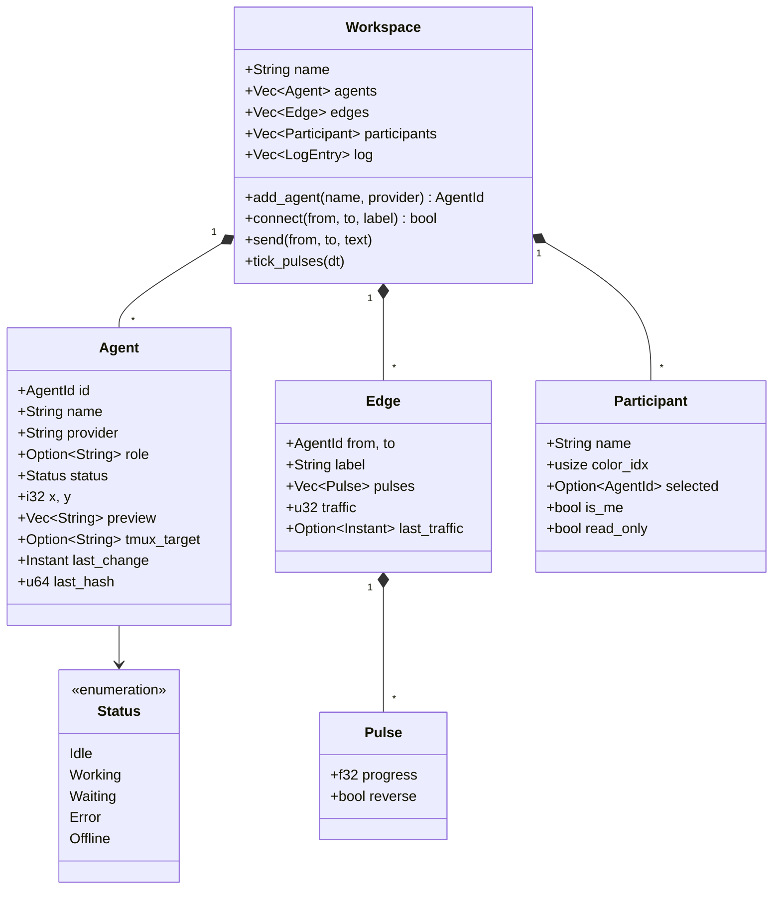
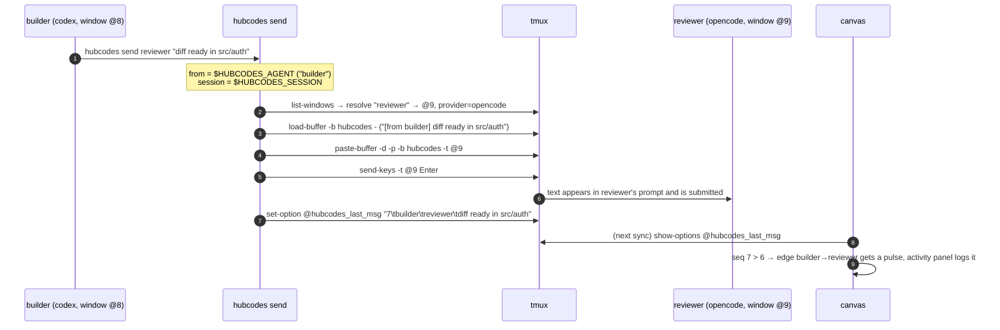
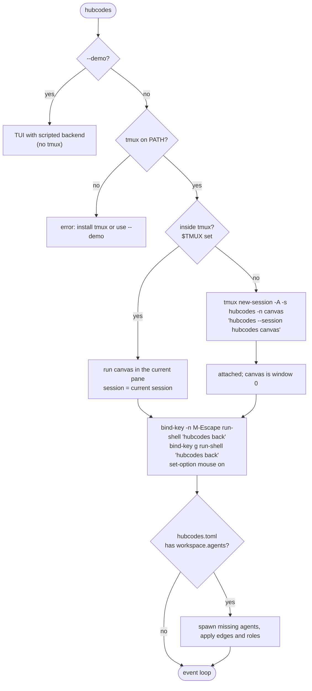
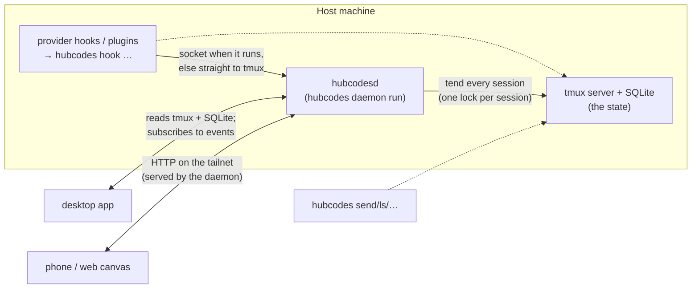

# Architecture

Status legend: **observed** = implemented and exercised in the spike (2026-11-11); **designed** = specified, not built.

## 1. Overview

hubcodes is three things that share one piece of state:

1. a **TUI canvas** (`hubcodes canvas`, or just `hubcodes`) that renders agents, links and messages;
2. a **CLI** (`hubcodes spawn|send|connect|read|ls|kill`) that agents and humans call from any shell;
3. a **tmux session** that owns every agent PTY and, in the spike, also carries the shared state in session options.

The daemon (`hubcodesd`, section 8) is optional: it tends sessions, takes hook reports and pushes events while the app is closed; the state itself stays in tmux and SQLite.



Design rule behind this: **tmux already solves PTY ownership, detach/attach, multi-client and focus.** hubcodes only adds a map and a message path on top. The agents never know they are on a canvas; they see a terminal and a `hubcodes` binary on `PATH`.

## 2. Module map (observed)

```
crates/hubcodes-core/   shared: tmux backend, providers + discovery (models.rs), relay.rs (deliver, loops, approvals), remote.rs (peers over SSH), hooks.rs (status from the agents), db.rs (SQLite transcript, usage), git.rs (worktrees, diff), tasks.rs (board), fanout.rs, prompts.rs, notes.rs, team.rs, triggers.rs, tend.rs (dispatch / reminders / budgets / triggers), serve.rs (+ serve.html: phone and teammate page)
crates/hubcodes/        TUI + CLI binary `hubcodes`
desktop/                Tauri 2 + React desktop app
  src-tauri/src/lib.rs  commands (snapshot, spawn, instruct, connect, layout, get/save_config) + 500 ms snapshot poll; adopts the login shell's PATH at start (Finder launches get the minimal one); the poll also raises OS notifications on the needs-you edge (window unfocused) and sets the Dock badge
  src-tauri/src/stream.rs  live pane output: tmux pipe-pane → FIFO → `pane:<id>` events (pipe first, screen snapshot once the pane is quiet, then live; strips `ESC k … ESC \` titles xterm.js would print); input via send-keys -H; size via resize-window
  src/canvas/           React Flow canvas: AgentNode (xterm.js + composer; compact name/status card below 55 % zoom), LinkEdge (orthogonal, pulses), zoom pill
  src/terminal/host.ts  one xterm per pane, kept alive across node ↔ sheet; fonts: bundled JetBrains Mono + Nerd symbols subset (src/fonts)
  src/ui/               rail, top bar, activity, sheet (open agent), dialogs (new agent, settings → hubcodes.toml), palette
  scripts/release-mac.sh  signed .app/.dmg build (`pnpm build:mac`)
  src/lib/mock.ts       browser-only backend for design work without tmux
```

TUI crate layout:

```
src/
├── main.rs        CLI (clap): launch logic, subcommands, terminal init/restore
├── app.rs         App state, event loop, key/mouse handling, frame layout, tmux sync
├── canvas.rs      Canvas widget: grid, edge pass, node pass, hit testing, ANSI preview
├── routing.rs     Orthogonal edge routing on the cell grid, port offsets, pulses (unit-tested)
├── model.rs       Workspace, Agent, Edge, Pulse, Participant, LogEntry
├── providers.rs   Provider registry + hubcodes.toml loading
├── layout.rs      Saved layout: node positions + camera per session, JSON under ~/.local/state (unit-tested)
├── tmux.rs        tmux wrapper: windows, capture, paste, focus, session-option state
├── demo.rs        Scripted backend with four fake agents (no tmux required)
└── theme.rs       Colours and glyphs
```

Dependencies: `ratatui 0.30` (crossterm 0.29 backend), `ansi-to-tui 8`, `clap 4`, `serde`/`toml`, `regex`, `anyhow`, `dirs`. No async runtime: the loop polls input with a 100 ms tick and calls tmux synchronously; with six agents one sync takes a few milliseconds.

## 3. Data model (observed)



Positions are canvas cells, independent of the camera. The camera (`ox`, `oy`, `zoom`) maps canvas cells to screen cells; compact zoom halves positions and uses a 22×3 node instead of 32×9.

## 4. Sync loop (observed)

Every tick (100 ms) advances pulses and expires toasts. Every fifth tick the backend reconciles:

```mermaid
sequenceDiagram
    autonumber
    participant UI as canvas (App::sync_tmux)
    participant T as tmux server
    loop every 500 ms
        UI->>T: list-windows -F "#{window_id} #{window_name} #{pane_current_command} #{pane_dead} #{@hubcodes_provider}"
        T-->>UI: windows
        Note over UI: new window → add Agent (saved position by name, else auto-placed)<br/>missing window → remove Agent + its edges
        loop each agent window
            UI->>T: capture-pane -p -e -J -S -12
            T-->>UI: last 12 lines (ANSI)
            Note over UI: hash lines; changed → last_change = now<br/>status = dead ? Offline : changed < 2.5 s ? Working : prompt-like ? Waiting : Idle
        end
        UI->>T: show-options @hubcodes_edges
        T-->>UI: "planner>builder>task,builder>reviewer>diff"
        UI->>T: show-options @hubcodes_last_msg
        T-->>UI: "seq\tfrom\tto\ttext"
        Note over UI: seq > last_seq → Workspace::send() → pulse + log entry
    end
```

Every tenth tick (1 s) and on quit, `App::save_layout` snapshots `(name → x,y)` for every agent plus the camera, merges in saved positions of agents that are not running right now, and writes `$XDG_STATE_HOME/hubcodes/<session>.json` (default `~/.local/state/hubcodes/`) only when the snapshot differs from the last write. Writes go to a `.tmp` file then `rename`, so a crash mid-write cannot truncate the file. The demo backend never writes.

The sync unit is a tmux *pane* (`list-panes -s`), not a window: pane ids survive `join-pane` / `break-pane`, which is how *open* and *tile* work. An agent pane whose window is the canvas window is flagged `open`; the canvas pane itself (`$TMUX_PANE`, also stored in the session option `@hubcodes_canvas_pane` for the CLI) is skipped. Agent name and provider are pane options (`@hubcodes_name`, `@hubcodes_provider`); a pane without them is named after its window.

Status is deliberately a heuristic in the spike. Phase 2 replaces it with provider hooks (Claude Code hooks, Codex `notify`, OpenCode plugin) reporting to the daemon; the heuristic stays as the fallback for providers without hooks.

## 5. Message path (observed)

`hubcodes send <to> "<text>"` is the only inter-agent primitive. It works from any process that can run a command, which covers every provider.



Rules:

- The `[from <name>]` prefix is added for agent providers and omitted for `shell`, because a plain shell would try to execute `[from`.
- `paste-buffer -p` uses bracketed paste so multi-line prompts are not submitted line by line; the trailing `Enter` submits.
- Only the **last** message is stored in tmux options. That is enough to animate; the full history lives in the canvas log for the life of the canvas and moves to the daemon in phase 2.

## 6. Launch logic (observed)



Open is `tmux join-pane -d -h -s <agent> -t <canvas>` plus `select-layout main-vertical` with `main-pane-width 38`, then `select-pane` on the agent. The agent's own UI is untouched: it is the same pane, resized. Back is `break-pane -d -s <agent> -n <name>` for every agent pane in the canvas window, then `select-pane` on the canvas; `Alt+Esc` and `prefix g` run `hubcodes back` through `run-shell`, so they work from inside any agent.

## 7. Rendering pipeline (observed)

1. **Grid**: a dot every 6×3 cells, offset by the camera so it pans with the content.
2. **Edges**, three passes: (a) assign each edge a port slot per (node, side) so two edges leaving the same side get different rows; (b) rasterise lines with box-drawing glyphs, heavy when the edge carried traffic in the last 8 s or touches the selected node; (c) labels at the midpoints, then pulses (`●`) on top.
3. **Nodes**: blank the footprint, draw the block (thick border when selected, guest colour when a guest has it selected), title `status-glyph name · provider-glyph provider [role]`, body = last lines of the pane parsed by `ansi-to-tui`, footer = `⇄ n` links and the status word.
4. **Overlays**: top bar (workspace, backend, counts, participants), bottom key bar with toasts, centred popups for help / message / instruct / spawn / kill.

Routing details and the reasoning behind them are in [ui-ux.md](ui-ux.md#4-edges).

## 8. The daemon (`hubcodesd`, built 2026-11-14)

The spike's "tmux options as state bus" turned out to be enough for the *state*: agents, links, status and the message log live in tmux options and SQLite, and every client (app, TUI, CLI, web page) reads and writes them directly. What needed a long-lived process was the *tending* (dispatch, reminders, triggers, trackers, queued deliveries), the phone page, and a place to push events from. That is `hubcodesd`: `hubcodes daemon run [--serve]`, one process per machine, kept alive by launchd.



| Concern | Without a daemon | With `hubcodesd` |
|---|---|---|
| state (agents, links, status, messages, tasks) | tmux options + SQLite, read by every client | the same; the daemon is one more client |
| tending (dispatch, nudges, triggers, trackers, merges, outbox) | whichever client holds `<session>.tend.lock` (the app, or `hubcodes watch`) | the daemon takes the lock for every session with agents, every 5 s; the app stands by and shows *tended by hubcodesd* |
| hook reports (`hubcodes hook …`) | written to the pane by the hook process | sent to the daemon's socket, which writes them, runs the turn-end bookkeeping and pushes a `status` event; falls back to the direct path when the socket is down |
| events | each client sees only what it did | `subscribe` on the socket streams `status`, `message` and `tend` events; the app forwards the daemon's tend events to its activity panel and notifications |
| phone page / web canvas | `hubcodes serve` or the app's Start server | `--serve` hosts it from the daemon for `HUBCODES_SESSION` |

Socket: `~/.local/state/hubcodes/hubcodesd.sock` (`HUBCODES_SOCKET` overrides), one JSON object per line, `{"id", "method", "params"}` → `{"id", "result" | "error"}`. Methods: `ping` (pid, version, tended sessions, subscriber count), `sessions`, `agents`, `send` (`session, from, to, text, now`), `hook` (`session, agent, status, detail, turnDone, transcript`), `events`, `tend` (a pass now), `subscribe` (`session` filter optional; the connection then receives `{"event", "session", "data", "at"}` lines). `hubcodes daemon status` shows the launchd state and what the socket answers. The old per-session `hubcodes watch --serve` LaunchAgents are retired by `hubcodes daemon install`; `hubcodes watch` itself still works for one session from a terminal.

The MCP server (`hubcodes mcp`) stays a per-agent stdio process: it reads the same state and does not need the daemon.

## 9. Resource budget (observed on this machine, informal)

- `hubcodes` debug binary: ~6 MB RSS idle; the 500 ms sync with three windows costs a few milliseconds of tmux round-trips.
- tmux server: ~5 MB.
- Each agent CLI: 200–400 MB (Node-based agents dominate). The orchestrator is not the cost; the agents are.

These were read from Activity Monitor during the spike, not measured rigorously.
