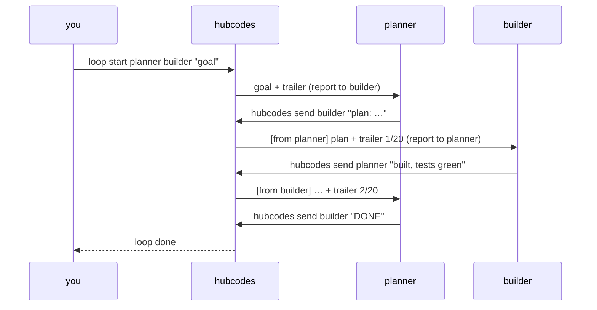
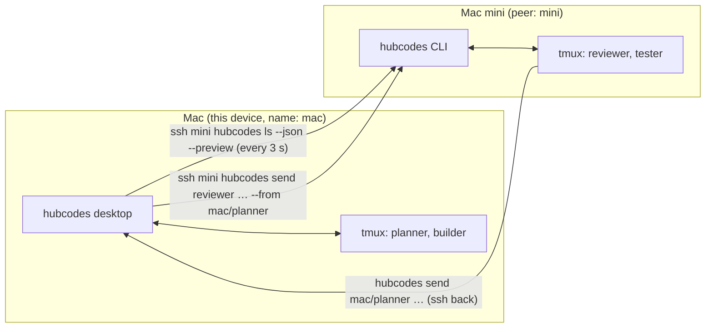

# Loops and devices

Two features on top of the message path (`hubcodes send`): agents that keep answering each other until a goal is met, and agents on another machine that take part as if they were local. Both are built, both run through tmux session options, no daemon.

## 1. Loops

### What a loop is

A loop is a link between two agents (`a ↔ b`) that hubcodes treats as a conversation with rules:

1. Every message along the link gets a **trailer** telling the receiver how to answer:

   ```
   [hubcodes loop 3/20] When you finish this step, send the result to a with:
     hubcodes send a "<your result>"
   If the goal is fully met, send a the single word DONE instead.
   ```

2. hubcodes counts **rounds** (one message along the loop = one round). At the limit (default 20, `[loop] max_rounds` in `hubcodes.toml`, or per loop) the message is still delivered but without a trailer, the loop is marked *paused*, the desktop shows a notification and the link turns amber. *Resume* on the link gives it a fresh counter. `0` (Settings → Agents → Round limit → No limit, or `hubcodes loop start a b --max 0 "goal"`) removes the limit: the loop runs until an agent answers DONE, you pause it, or a token budget is reached.
3. A reply that starts with **`DONE`** ends the loop (*done*). Links and agents stay.
4. An agent that owes a reply and has been idle for 20 s gets one reminder pasted into its terminal (`[hubcodes] b is waiting for your answer…`). One reminder per message; after that it is your call.

The agents do the talking themselves: hubcodes never captures a screen and forwards it. That keeps the exchange explicit (every message is in the activity log) and works for any CLI that can run a shell command.

### Starting one

- **Desktop**: select a link → **Loop…** → choose who starts, write the goal, start. Or right-click an agent → *Loop with X…*, or `⌘K` → *Loop a ↔ b with a goal…*. The link shows `↻ rounds/max`, dashed while running, amber when paused. Selected link: *Goal…* (send a new goal), *Resume*, *Loop off*, *Remove*.
- **CLI**:

  ```bash
  hubcodes loop start planner builder "Ship the token store with tests" --max 30
  hubcodes loop status
  hubcodes loop on reviewer builder      # make an existing link a loop
  hubcodes loop reset planner builder    # resume after a pause
  hubcodes loop off planner builder      # plain link again
  ```

### Sequence



### Why agents comply

The role prompt (`role_flag`, on by default for claude, pi and omp) tells the agent on start that teammates message it as `[from name]` and that it answers with `hubcodes send`. The trailer repeats the exact command. Codex and OpenCode have no role flag yet; the trailer alone is usually enough because it is a literal command.

## 2. Devices

### Model

Each machine runs its own hubcodes and its own tmux session with its own agents and credentials. Nothing is copied; the other machine's agents show up on your canvas as `device/agent`, you can link, loop and message them, and their agents can message yours. Transport is SSH (Tailscale SSH or an SSH key), one command per message or poll, nothing listens on a port.



### Setup, both machines

Settings → Devices → **Pair with another Mac** walks through this and shows which steps this Mac has already done; `hubcodes peer me` prints the same from a shell. Do it on both Macs.

1. **hubcodes on both, same release.** Open hubcodes.app once on each Mac: it installs `~/.local/bin/hubcodes`. Install tmux with `brew install tmux`.
2. **Same tailnet.** Install Tailscale on both Macs and sign in with the same account. Each Mac then reaches the other by its short name (`tailscale status` lists them), at home or away. On one local network the `.local` name works too.
3. **Remote Login on, on both.** System Settings → General → Sharing → Remote Login. *Open Sharing* in the pairing steps goes there. This is what lets the other Mac run `hubcodes` here over SSH.
4. **Let each Mac in on the other.** SSH has to work without a password prompt, in both directions. On this Mac, step 3 of the pairing steps has *Copy command*. Paste that line once into Terminal on the **other** Mac: it adds this Mac's public key to `~/.ssh/authorized_keys` there, and running it twice adds nothing. *Create key* makes `~/.ssh/id_ed25519` first when this Mac has none. Instead of the pasted line, `ssh-copy-id user@other-mac` does the same and asks for that Mac's password once. Then repeat in the other direction.
5. **Name each Mac and add the other.** In Settings → Devices, give this Mac a short name (`mac`). Then press *Add device* and enter the other Mac's name, SSH host and user, exactly as that Mac shows them under its own pairing steps. Press **Test**. When a step is missing, the test says which one:
   - `Permission denied`: step 4 is not done.
   - `Connection refused`: Remote Login is off there.
   - `Could not resolve` or `timed out`: the Mac is asleep, or Tailscale is off.
   - `tmux not found`: run `brew install tmux` on that Mac.

   From a shell:

   ```bash
   hubcodes peer add mini mac-mini --user aldo   # tests the connection and prints the line for the other Mac
   hubcodes peer me                              # what the other Mac needs from this one
   hubcodes peer check                           # versions, names and pairing, both ways
   ```

   Or in `hubcodes.toml`:

   ```toml
   [sharing]
   name = "mac"                      # how this device appears to peers

   [[peer]]
   name = "mini"                     # what that Mac calls itself
   host = "mac-mini"                 # anything `ssh` accepts; "local" = another session on this machine
   user = "aldo"                     # optional
   session = "hubcodes"
   hubcodes = "hubcodes"             # found in ~/.local/bin, Homebrew or ~/.cargo/bin there; a full path or ~/… also works
   ```

   On the Mac mini, the mirror entry points back at the Mac.
6. **Try it.** Run `hubcodes send mini/reviewer "diff is ready"` on the Mac. On the mini, the reviewer sees `[from mac/planner] diff is ready` and answers with `hubcodes send mac/planner "…"`.

How the commands run on the other Mac: over SSH, a command gets a bare `PATH` (`/usr/bin:/bin:…`), and a login `bash` does not read `~/.zprofile`, which is where Homebrew adds itself. So hubcodes puts `~/.local/bin`, `/opt/homebrew/bin`, `/usr/local/bin` and `~/.cargo/bin` on the PATH of every command it runs there, including *Open*'s `tmux attach`. No shell file needs editing. The first connection to a device records its host key (`StrictHostKeyChecking=accept-new`). A host key that changes later is still refused, with the `ssh-keygen -R` line to clear it.

A person's message to an agent on another Mac is still a person's message there. When that agent is on a team, it checks with the lead there first. `--direct` (⌥Enter) travels with the message, so it skips the lead on that Mac too.

### On the canvas

- Remote agents are cards with an **on mini** tag. Their terminal is a preview (last 12 lines, refreshed every 3 s over SSH), not a live PTY. The composer, `@mini/reviewer` mentions, links and loops work the same.
- **Open** on a remote card starts a local tmux pane running `ssh -t mini tmux attach -t hubcodes:reviewer`, so the full-size view *is* live and typing goes to the agent there. Closing the sheet leaves that pane; it is tagged `proxy` and never shown as an agent.
- **Runs on** in New agent (and a *Runs on* column in Settings → Teams) starts an agent on another device: that device's own `hubcodes spawn` runs it with its own tool and credentials, and it appears here as `device/name` (`hubcodes spawn reviewer -p codex -r reviewer --on mini` from a shell).
- **One board across devices.** An unowned To do task first goes to an idle agent here; when none fits, to an idle agent on another device, same role first. Its assignment names the home board (`hubcodes task done mac:3 "…"`), and that command on the other device is forwarded back here over SSH, reported as `mini/reviewer`. Both devices need each other as peers for the round trip.
- **Teammates on other devices are in the brief.** An orchestrator started here lists `mini/reviewer (reviewer)` among its engineers and reviewer and is told that `hubcodes send mini/reviewer` works the same; the delegation guard names them too. This reads the peer cache (`~/.local/state/hubcodes/peers-<session>.json`), written by the app's device poll, by `hubcodes peers`, and by hubcodesd.
- **When a device is away.** A `task done mac:3` that cannot reach `mac` is queued on the reporting device (`~/.local/state/hubcodes/remote-queue-<session>.json`) and retried by every tend pass (app, `hubcodes watch`, hubcodesd) for two days. On the board's side, a task held by `mini/reviewer` while `mini` is unreachable raises an alert and shows *away · reassign…* on the card. Nothing moves to another device on its own: agents of a Mac that went down are not recreated elsewhere, so the other Mac is never loaded by a failure.
- **Coming back.** hubcodesd restores every session that has a saved definition and no running agent when it starts (the LaunchAgent starts it at login), with the providers' resume flags; the app's Restore banner does the same by hand.
- **Limit per device.** Settings → Devices → *Most agents* (`max_agents` on the `[[peer]]`): starting one more agent there from here is refused past that number.
- **Orchestrators on other Macs** are in the brief and the guard as targets for whole parts: `hubcodes send mini/lead "part: goal, repo and branch, done-when"`; the lead there splits it among its own engineers over its own board and reports back as `[from mini/lead]`.
- **Idle is measured there.** `hubcodes ls --json` keeps a hash of each agent's last screen lines on its pane and reports how long it sat still; a device's agent counts as idle for dispatch only after 5 quiet seconds, like a local one. Its tool's own hook status (fresh) wins when present.
- **Polling is adaptive and shares one SSH connection** per host (ControlMaster, kept a minute): every 3 s while something moves there, 15 s when every agent sits quiet, 60 s while a device is away. A `hubcodes send device/agent` that cannot reach the device joins the remote queue like a task report. Settings → Devices → a device shows reachability, the last poll, what is queued, and *Poll and retry now*; the model picker for an agent on that device reads its catalog (`hubcodes providers --json` over SSH, cached 5 min).
- **`--as` is checked.** A forwarded report arrives over SSH; when Tailscale is installed, `tailscale whois` on the connection's address must name the device the report claims, else it is refused. Without Tailscale (LAN SSH, `host = "local"`) the claim is taken.
- **Pairing and versions are checked.** `hubcodes peer check` (and Settings → Devices → a device → *Pairing*, and `hubcodes doctor`) read the device's version, what it calls itself and which devices it lists, and say what is off: a different release, a name that does not match (`mini` here must be that Mac's `self_name`), or this Mac missing from its devices. `hubcodes peer add <name> <host> [--allow …]`, `peer rm`, `peer queue [--retry]` edit and inspect the same `[[peer]]` entries the Settings dialog does.
- **What a device may do here** is per `[[peer]] allow` (Settings → Devices → *May do here*): `send`, `task`, `spawn` by default; `approve` (answering agents' permission prompts), `kill` and `restart` only when listed. The check applies when the SSH caller can be told apart with `tailscale whois`; over plain LAN SSH or `host = "local"` every command is taken, as before.
- Remove is only offered on the agent's own device.
- The top bar shows `N devices`, or `1 device unreachable` with the SSH error in the tooltip.

### Trying it on one machine

A peer with `host = "local"` and a different `session` shows that session's agents as a device, with the same code path minus SSH:

```bash
tmux new-session -d -s hubcodes-mini
hubcodes --session hubcodes-mini spawn reviewer -p claude
# [[peer]] name = "mini", host = "local", session = "hubcodes-mini"
hubcodes send mini/reviewer "hello from the other session"
```

`scripts/test-peers-local.sh` does the whole two-device round trip this way with throwaway configs, state and sessions (`hubpeerA-<pid>`, `hubpeerB-<pid>`): peer cache and roster, the guard naming `b/dev`, a To do task handed to `b/dev` with the `a:1` id, `task done a:1` landing on a's board, a report queued while a is "down" and delivered on the next `hubcodes watch --once`, `max_agents` refusing a second agent, the redacted snapshot, and the federation listener (send through it, its allow list, a missing token, a verb off the list, `auto` falling back), someone else's device being view only, and rooms across the two devices. Run it after `cargo build -p hubcodes`; it never touches your own sessions or config.

### Without SSH: the federation listener

A device can also take requests from its peers through its own `hubcodesd`, so a hop is one HTTP request on the tailnet instead of an SSH session (built 2026-11-15, opt-in).

On the device that is reached, in `hubcodes.toml`:

```toml
[sharing]
name = "mini"
listen = true              # hubcodesd also listens for its peers
# listen_bind = "tailscale" # default: this Mac's tailnet IP; loopback is allowed, a LAN address is refused
# listen_port = 7434
```

On the device that reaches it, per `[[peer]]` (or Settings → Devices → *Reach it through*):

```toml
[[peer]]
name = "mini"
host = "mac-mini"
transport = "auto"   # listener first, SSH while it is not there; "http" = listener only; "" = SSH (default)
# port = 7434
```

What the listener accepts: `GET /fed/v1/hello`, `GET /fed/v1/watch` (the long poll above) and `POST /fed/v1/run` with a `hubcodes` command from a fixed list (`send`, `task done|review`, `spawn`, `approve|deny`, `kill`, `restart`, `ls --json`, `providers`, `--version`), run there with the caller named in `HUBCODES_FED_CALLER`, so the same `[[peer]] allow` and `--as` checks apply as over SSH. The caller is the `[[peer]]` whose host `tailscale whois` matches; anything else gets 403. When `HUBCODES_FED_TOKEN` is set in the environment of both daemons, every request must carry it as well; loopback requests are accepted only with it. `hubcodes daemon listen` runs the listener alone in the foreground (debugging, the peer test). With `auto`, a device whose listener is missing (refused, 401/404, unreachable) is reached over SSH for the next five minutes; a request the listener accepted is never repeated over SSH.

Snapshots a peer reads (`hubcodes ls --json --preview`) redact secret shapes, and a private agent sends no screen at all.

### Someone else's device

A device signed in to another Tailscale login than this Mac (a teammate's Mac, found with `tailscale whois`) is view only while its `allow` is empty: it can read the agent list, its `send` and room posts wait for your approval (Inbox → *Teammates' messages*, or `hubcodes pending`, `hubcodes pending approve <id>`), and `spawn`, `task`, `approve`, `kill`, `restart` are refused. Name actions in its `allow` (Settings → Devices → *May do here*) to trust it with them.

### Rooms

A room is a named group of agents, here or on any device, that hear each other's posts.

```sh
hubcodes room create design lead mini/dev   # on the device the room lives on (its home)
hubcodes room post design "schema is in"    # on the home
hubcodes room post mac:design "on it"       # from another device: home:room
hubcodes room show design                   # transcript (home only)
hubcodes room add|rm design <member…>; hubcodes room list; hubcodes room delete design
```

Agents use the MCP tool `room_post` the same way; in the app, **Rooms** in the header lists the rooms on this Mac with their members and transcript, and posts as you. A post is redacted, written to the home's transcript and delivered to every other member as `[room design] <sender>: <text>`, through the same relay as `hubcodes send` (so a member on an unreachable device gets it later from the queue). A post sent while the home is unreachable waits in the sender's remote queue. Only the home's owner creates rooms or changes members (those commands are refused over SSH and are not on the federation list); a member must be in the room to post.

### Limits

- Previews are polled; a remote card's *working / needs you* lags by up to 3 s.
- Loop state lives on the device where the loop was started; the other side only sees the trailers.
- Over SSH each `hubcodes send` to a peer is one SSH command (the shared ControlMaster connection keeps it near 0.3 s); through the federation listener it is one HTTP request.
- Over SSH, remote cards are polled (3 / 15 / 60 s). A device reached through its listener is followed with a long poll (`GET /fed/v1/watch`): the answer comes when its agent list changes (the listener checks every second; quiet time only counts once an agent is still for 5 s), otherwise after 25 s.
- Credentials never cross: a remote agent runs with the remote machine's logins and repositories.
