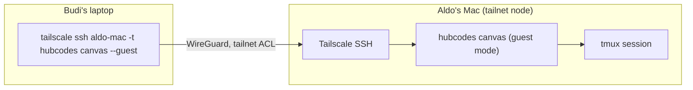
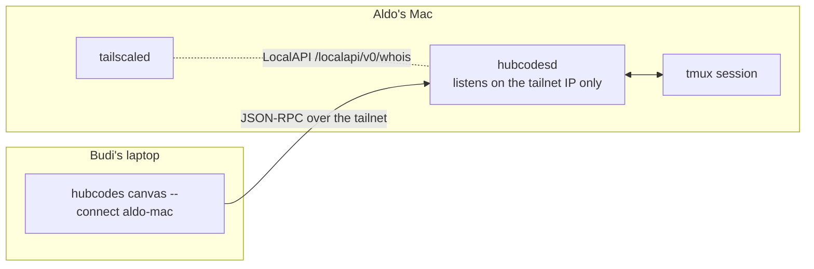

# Sharing and security

Goal: a teammate on the same Tailscale tailnet opens my canvas from their own machine, sees the same agents, links and activity, and — when I allow it — talks to the agents. Everything in this document is **designed**; the spike only renders a fake guest (`budi (ro)`) in demo mode so the presence UI could be judged.

> Built since 2026-11-11: **agents on several of my own machines** (topology C in spirit, over SSH, no daemon). See [loops-and-devices.md](loops-and-devices.md). Sharing a canvas with *another person* and the permission model below remain design.

## 1. What is being shared

Sharing a canvas means sharing **access to processes that hold my credentials**: the agents are logged in as me (Claude, Codex, GitHub) and run inside client repositories. Whoever can type into an agent can make it run `git push`, read `.env`, or call any tool I have authorised. The permission model below exists because of that, and the default is read-only.

## 2. Topologies

### A. SSH over Tailscale (phase 3, first)

- Zero transport code: Tailscale SSH authenticates Budi with his tailnet identity and the ACL decides who may SSH to the host.
- The guest canvas runs **on the host** and attaches to the same tmux session; multi-client is tmux's job.
- Weakness: Budi has a shell on my machine. `--guest` restricts the canvas, not the shell. Only acceptable with people who could have a shell anyway, or when the host is a dedicated VM.

### B. Daemon on the tailnet with identity (phase 3, target)

- `hubcodesd` binds **only** the tailnet interface (100.x.y.z), never 0.0.0.0.
- On every new connection the daemon asks `tailscaled`'s LocalAPI `whois` for the peer: it gets `budi@hubstudio.id` and the device name without any login flow. Rust does not have `tsnet`; `tailscaled` on the host plus the LocalAPI (unix socket, no network) gives the same identity guarantee.
- Budi gets **no shell**. The daemon exposes exactly the operations in the table below, each checked against his role.
- Tailscale ACLs gate who can even reach the port (`tcp:7433`, say) and can be tightened per tag.

### C. Federation (first slice built 2026-11-15)

Every person runs their own daemon; daemons peer over the tailnet. Built so far: the `hubcodesd` federation listener (opt-in, tailnet or loopback only, caller = the `[[peer]]` matched by `tailscale whois`, optional shared `HUBCODES_FED_TOKEN`, a fixed verb list behind the same `allow` checks), see `docs/loops-and-devices.md`. The desktop follows a device through the listener's long poll. Rooms and the viewer rule for other people's devices: see *Decided 2026-11-15* below. Budi's agents run on Budi's machine with Budi's credentials and appear on a shared room with mine. Nobody types into someone else's agent; agents message each other through their own daemon. This is the healthiest model for client work (Hermina, PMP, MLM repositories never leave the machine whose owner is cleared for them) and is the reason the message primitive is a CLI and not a shared PTY.

## 3. Permission model (B and C)

| Role | See canvas, previews, activity | Move nodes, zoom (own view) | Send messages to agents | Instruct / focus into a terminal | Spawn / kill / connect | Approve guest input |
|---|---|---|---|---|---|---|
| viewer (default) | yes | yes (local) | no | no | no | no |
| contributor | yes | yes | **queued for owner approval** | no | no | no |
| operator | yes | yes | yes | yes, on agents the owner flagged *shareable* | yes | no |
| owner | yes | yes | yes | yes | yes | yes |

Rules:

1. New guests are viewers. Promotion is an owner action in the canvas (`p` on a participant), per session, not persisted across restarts unless the owner says so.
2. Contributors' messages appear in the owner's activity panel as *pending*; `a` approves, `d` drops. Agents never see unapproved text.
3. Operators can only enter terminals of agents marked *shareable*. Shareable agents must run in a separate worktree or container; the canvas refuses the flag on an agent whose `cwd` is the main checkout.
4. Every write (message, instruct, spawn, kill, connect, approval) is logged with the tailnet identity, the device, and a timestamp (`Asia/Jakarta` in the UI, UTC on disk).
5. Previews can leak: a `.env` printed by an agent is visible to viewers. The owner can mark an agent *private* (preview replaced by its status; `hubcodes private <agent> on`, pane option `@hubcodes_private`) and the server redacts common secret shapes (`sk-…`, `ghp_…`, `AKIA…`, `xox…`, `AIza…`, JWTs, `Bearer …`, PEM private keys, `password=` / `token=` style values) in previews, last lines, messages and history before they go to anyone below the owner (`redact.rs`, built 2026-11-14). Redaction is a safety net, not a guarantee.

## 4. Threat model

| Threat | Topology | Mitigation |
|---|---|---|
| guest runs arbitrary commands via an agent | A, B | A: don't use A with people who may not have a shell. B: viewer default, approval queue, shareable flag |
| guest reads client code or secrets from previews | A, B, C | private agents, redaction, per-agent sharing, Tailscale ACL by tag so only cleared people reach the daemon |
| daemon reachable from the LAN or the internet | B | bind tailnet IP only; no port forward; refuse to start if the bind address is not a Tailscale address |
| spoofed identity | B | identity comes from `tailscaled` LocalAPI `whois` on the host, not from the client; LocalAPI is a unix socket owned by root/the user |
| a prompt injection in one agent's output makes another agent act | all | messages are text pasted into a prompt; agents must treat `[from …]` text as data. The prompt snippet in [providers-and-protocol.md](providers-and-protocol.md) says so. v1 adds a per-link allowlist of who may message whom |
| replay / tampering on the wire | B, C | WireGuard (Tailscale) encrypts and authenticates; the daemon still gives every message an id and rejects duplicates |
| guest DoS by flooding messages | B, C | per-identity rate limit (e.g. 10 messages/min for contributors), owner can mute |

## 5. What hubcodes will not do

- No account system, no cloud relay, no telemetry. Identity is the tailnet's job.
- No sharing outside a tailnet in phase 3. A public relay would turn "my laptop" into a server; that is a different product.
- No silent escalation: a guest never gains a capability without an owner action that is visible in the activity panel.

## 6. Open questions

1. Should contributor messages be delivered automatically after a timeout when the owner is away, or always wait? (Default: always wait.)
2. Which Tailscale ACL tags do we standardise on at HUB (`tag:hubcodes-host`, `tag:hubcodes-guest`)? Needs the tailnet admin.
3. Does the HUB policy on client data allow previews of client repositories to be shown to another HUB employee at all, or must sharing be federation-only (C) for those projects? This is a policy decision, not a technical one.

### Decided 2026-11-15 (Aldo)

- **Federated requests are authenticated by tailnet identity alone**: `tailscale whois` matched to a `[[peer]]` host, with the listener port restricted by Tailscale ACL tags. `HUBCODES_FED_TOKEN` is optional and meant for loopback and tests; no shared token to issue or rotate.
- **Someone else's device starts as a viewer.** A device whose Tailscale login differs from this Mac's reads agent lists only; with an empty `allow` it cannot send, task or spawn. Its messages (and room posts) wait in the Inbox for approval (`hubcodes pending`), attributed as `device/agent`. Listing actions in its `allow` lifts that. When either login cannot be told, the device counts as someone else's.
- **Rooms have no server.** A room lives on the device that created it (its home), and only that device's owner creates it or changes its members. The home keeps the only transcript; members elsewhere receive the posts addressed to them; each device keeps its own record of what it sent and received (messages and `room` events). While the home is offline, posts wait in the remote queue. Rooms carry redacted messages, never screens.
