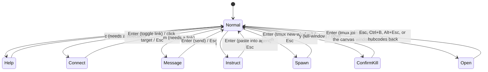

# UI and UX

What the canvas looks like, why, and the rules the renderer follows. Screens referenced here are in [screenshots/](screenshots/).

## 1. Principles

1. **The canvas is a map, not a terminal.** It answers "who is doing what, who is waiting on whom" at a glance. Reading an agent's full output is focus mode's job.
2. **Agents stay native.** Focus mode is the agent's own tmux window. We never wrap or re-render an agent's UI.
3. **Two zoom levels, not a continuum.** Cells cannot scale, so zoom is *full* (32×9 nodes with an 7-line preview) or *compact* (22×3 one-line nodes). Each level is designed, not interpolated.
4. **Status is colour + glyph + word.** Never colour alone: `○ idle`, `● working` (blinks), `◐ needs you`, `✖ error`, `· offline`.
5. **Everything is reachable from the keyboard; the mouse is a shortcut.** Drag, click, wheel and right-click all work over SSH with tmux mouse mode, but no action requires them.

## 2. Anatomy of the screen

```
 hubcodes · demo · auth-refresh · demo · 4 agents · 4 links            ● aldohub  ◆ budi (ro)   ← top bar
·     ·     ·     ·     ·     ·     ·     ·     ·     ·     ·     ·   │ activity              ← grid + log
  ┏ ○ planner · ✦claude [lead] ━━┓              ╭ ◉ builder · ◇codex ───╮   │ 2s builder → planner
  ┃> breaking down: auth refresh ┃━━━━ task ━━━▶│  + fn refresh(&mut …) │   │    token store done
  ┃  1. token store (builder)    ┃              │  + tests::refresh_…   │   │
  ┗ ⇄ 3 ━━━━━━━━━━━━━━━━━━ idle ┛              ╰ ⇄ 2 ──────── working ╯   │
                  ┃ e2e                               ┃ diff                 │
 type  instruct   Tab  select   Enter  open   ^T  tile all   ^N  new …     ← key bar + toasts
```

- **Top bar**: workspace name, backend (`demo` or `tmux:<session>`), counts, zoom state; right side lists participants (`●` you, `◆` guests, `(ro)` read-only).
- **Grid**: a dot every 6 columns × 3 rows, panning with the camera. It gives the eye a reference when dragging and makes "infinite" legible.
- **Activity panel** (right, 34 columns, `Space` toggles): newest first, `age from → to` then the message. Hidden automatically when the terminal is narrower than 70 columns.
- **Key bar**: changes with the mode; toasts (errors, confirmations) append on the right for 3 s.

## 3. Node

```
┏ ◉ builder · ◇codex [build] ━━━━━━━━┓   title: status glyph, name (provider colour), provider glyph+name, [role]
┃  + fn refresh(&mut self) -> Result ┃   body: last 7 lines of the pane, ANSI colours kept, truncated (no wrap)
┃ $ cargo test auth::                ┃
┃ ✓ 12 passed, 0 failed              ┃
┗ ⇄ 2 ━━━━━━━━━━━━━━━━━━━━━ working ┛   footer: link count, status word
```

| State | Border | Note |
|---|---|---|
| normal | rounded, grey | |
| selected (you) | **thick**, provider colour | only one node is selected at a time |
| selected by a guest | rounded, guest colour, guest's name as a tag in the top-right | Figma-style presence; see [sharing-and-security.md](sharing-and-security.md) |
| partially off-screen | clipped at the canvas edge | the remainder is reachable by panning |
| compact zoom | 22×3, title only | preview hidden, footer hidden |

Provider colours (xterm-256): claude 215, codex 252, opencode 80, pi 176, omp 114, gemini 75, shell 245. Configurable per provider.

## 4. Edges

Edges are **orthogonal polylines with at most two bends**, drawn with box-drawing glyphs and an arrowhead into the target. Reasons: diagonal lines look broken at cell resolution, and axis-aligned paths make the pulse animation a simple walk.

Routing rules (see `src/routing.rs`, unit-tested):

1. Pick sides: if the target is beside the source (horizontal gap ≥ vertical gap) leave from the facing side (left/right), otherwise from top/bottom.
2. Ports: when several edges share one side of a node, each gets its own slot (rows 2 apart on left/right, columns 4 apart on top/bottom), centred on the side. This is what keeps `task` and `verdict` from overlapping on the planner's right side.
3. If the two ports differ by one row (or two columns), snap them equal: a one-cell jog reads as a glitch.
4. Path = port → midpoint of the gap → turn → port. Corners use `┌ ┐ └ ┘`; arrowheads `▶ ◀ ▼ ▲`. When that path would cross another node (at either zoom), the router searches for a detour instead (A* on the cell grid with a turn penalty, one cell of air around other cards where there is room); only when no detour exists does it fall back to the direct line (`route_avoiding`, unit-tested).
5. Labels are drawn after all lines, at the midpoint, italic grey, surrounded by one space so they punch a gap into the line.
6. Pulses (`●`, yellow) are drawn last. A pulse walks the path in about 1.4 s; a reverse pulse (message against the edge direction) walks backwards.
7. Line weight: **heavy** (`━ ┃`) when the edge carried a message in the last 8 s or touches the selected node; light otherwise. Colour: blue when active, grey when quiet.

Compact zoom halves node positions; the obstacle-aware router (above, 2026-11-14) keeps edges out of other nodes there too.

## 5. Interaction model



Mouse (crossterm mouse capture, switched on at start and off on exit; tmux passes it through with `set -g mouse on`; exercised end to end on 2026-11-14 by injecting SGR sequences through tmux against the demo):

| Gesture | Effect |
|---|---|
| left click on node | select (in Connect mode: connect to it) |
| left drag on node | move node (canvas coordinates, snaps to ≥ 0) |
| left drag on empty space | pan |
| right click on node | connect selected → node (toggle) |
| wheel | pan vertically; horizontal wheel pans horizontally |

Message popup: `message  builder → reviewer`, `Tab` cycles through the sender's neighbours, `Enter` sends. The text is pasted into the recipient's terminal as `[from builder] …`, so the recipient agent knows who is talking.

Open / tile / back: `Enter` on a node with an empty composer *opens* it: tmux `join-pane`s the agent's real pane into the canvas window (`main-vertical`, canvas = 38-column main pane on the left, agents stacked on the right) and focuses it. The canvas redraws as a sidebar: agent list with status and `▣` for open ones, the selected agent's composer, the activity log. `Ctrl+T` opens every agent (tiling-WM style); pressed again it cycles tmux's built-in layouts. `Esc` on the sidebar, `Ctrl+B`, `Alt+Esc` from inside an agent pane, or `hubcodes back` from any shell `break-pane`s them back to their own windows and the canvas fills the window again. `Ctrl+W` closes just the selected one. Because the tiled pane *is* the agent's terminal, typing there is direct, with no mirroring.

Instructing is type-first, as in Maestri and T3 Code: with a node selected, printable keys go into a composer drawn on the node's last rows (`› text▏`); `Alt+Enter` or `Ctrl+J` starts a new line (`Shift+Enter` too where the terminal reports it) and the box grows with the text up to six rows, wrapping long lines; `Enter` pastes the whole draft into the agent exactly as typed, newlines included (the activity panel shows a `⏎` per line break), and logs it under your name. The same composer sits in the sidebar when agents are tiled. An empty composer plus `Enter` opens the agent instead (see above). Each node keeps its own draft while you `Tab` around. `Space` marks the selected node for a group message (double border), `Shift+click` marks another, `Shift+drag` on empty canvas marks everything the box touches; `Enter` then sends the draft to every marked agent, `Esc` clears the marks. Because letters are input, every command lives on `Ctrl` + key (`^N` new, `^K` connect, `^G` message, `^X` kill, `^Z` zoom, `^L` log, `^O` reset camera, `^Y` next agent that needs you, `^Q` quit) and the key bar shows the `^` form; `F1` opens the help.

Needs-you markers and bell: when an agent is waiting for you but its card is outside the visible canvas, a yellow `! name` marker with an arrow sits on the canvas edge nearest to it, and the terminal bell rings once at the moment the agent starts waiting (not again while it keeps waiting). `Ctrl+Y` selects the next waiting agent and pans the canvas so its card is in view; press again to cycle.

## 6. Colour and typography

- Background is the terminal's own; we never paint a full-screen background so the canvas blends with the user's theme. Bars and popups use a slightly lighter grey (234/235).
- Text 252, dim 243, grid 236. Accent (selection, popups, toasts) 110. Pulses 221.
- Glyphs used: `○ ● ◉ ◐ ✖ · ⇄ ▶ ◀ ▼ ▲ ━ ┃ ┏ ┓ ┗ ┛ ─ │ ╭ ╮ ╰ ╯ ✦ ◇ ◈ π ◆ ✧`. All are in common monospace fonts; none require a Nerd Font. Agent previews may contain Nerd Font glyphs from the user's prompt; that is their choice.
- Terminals verified: tmux 3.8 inside Ghostty (the screenshots were rendered from tmux captures). Apple Terminal lacks true colour; indexed colours still work.

## 7. Known UX issues (spike)

| Issue | Impact | Plan |
|---|---|---|
| ~~positions reset on restart~~ | | done 2026-11-11: persisted per session |
| no multi-select, no box select | moving a group means moving nodes one by one | bands exist in the desktop app; TUI open |
| ~~compact zoom can route edges through nodes~~ | | done 2026-11-14: obstacle-aware routing |
| ~~status heuristic can mark a chatty but stuck agent as "working"~~ | | done: hooks for claude, codex, opencode, pi, omp |
| preview width counts cells, not glyph width, for some Nerd Font glyphs | a line may shift one cell | accept; previews are previews |
| ~~no notification when an off-screen node needs you~~ | | done 2026-11-14: edge markers, bell, `Ctrl+Y` |
